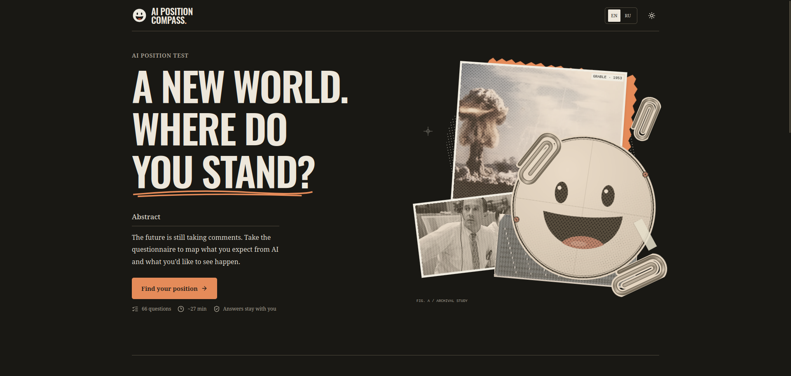

# AI Position Compass



AI Position Compass maps what you expect from artificial intelligence and what you want to happen. The test is available in English and Russian, with 66 core questions and an optional 15-question module about software development. It is an exploratory tool and has no scientific validation.

[Take the test in English](https://fleyreal.github.io/ai-position-compass/en/) · [Пройти тест на русском](https://fleyreal.github.io/ai-position-compass/ru/)

[Example result · Normal-technology camp with developer profile](https://fleyreal.github.io/ai-position-compass/en/result/?r=AQFEMEtcQBVGHTJSUEse)

## Small note :)

I’m FLEY. I spent quite some time researching how questionnaires like this work, the math behind them, and the rapidly evolving AI industry so I could build an accurate and engaging test.

Implementing the scoring logic was quite a challenge. It took a few tries to get it working. I ran a pilot with beta testers, collected valuable feedback, and made changes here and there to improve the interface, the user experience, and the scoring logic. I hope you’ll like it!

## How results are calculated

- **Axis scores.** The five agreement choices map to −1, −0.5, 0, 0.5, and 1. Neutral counts as a scored response. Unsure skips scoring. An axis needs scored answers to at least half of its primary questions, rounded up, including at least one question keyed in each direction. An axis with insufficient coverage is marked Undefined. Each response is multiplied by its question's direction and weighted at 1 for the primary axis or 0.5 for a configured secondary axis. The weighted average is mapped to 0–100 and rounded once.
- **Camp similarity.** Camps are example profiles. Core comparisons require at least four defining positions and three scored positions in common. For developer comparisons the minima are two and two. Similarity is 100 minus the root mean square of the differences across scored axes. If a camp leaves a scored axis open, that axis contributes a 20-point difference. Undefined axes are omitted. A score of at least 70 counts as a close match. The percentage measures distance between profiles and carries no probability of membership.
- **Public voices.** Linked statements illustrate ideas that overlap with a camp. The profiles make no claim of membership or endorsement.

The [technical specification](SPEC.md) describes the scoring and link format. Question definitions and camp positions are in the [scoring configuration](src/shared/config/scoring.ts).

## Privacy and exports

Answers stay in the browser and are saved locally when storage is available. Shared links contain versioned axis scores and the developer-module flag. The PNG contains a visual summary. JSON includes axis scores and camp comparisons and can also include your answers and localized question text when the browser still has the original completed test and can verify it against the result. Review the JSON before sharing it.

## Local development

Use the Node.js version in [.node-version](.node-version) and the pnpm version in [package.json](package.json).

```sh
pnpm install --frozen-lockfile
pnpm dev
```

`pnpm lint`, `pnpm test`, and `pnpm build` run the main checks. The production build writes the static site to `build/client`. Release and deployment steps are in the [project workflow](WORKFLOW.md#git-review-and-cleanup).

## License and credits

Project code is available under the [MIT License](LICENSE). Third-party artwork, fonts, source, and tools retain their applicable terms. See the [artwork credits](public/ASSET-CREDITS.txt), [software and font notices](public/licenses/), and [vendored skill notices](.agents/skills/THIRD_PARTY_NOTICES.txt). The production build also includes the notices for bundled JavaScript under `licenses/`.
